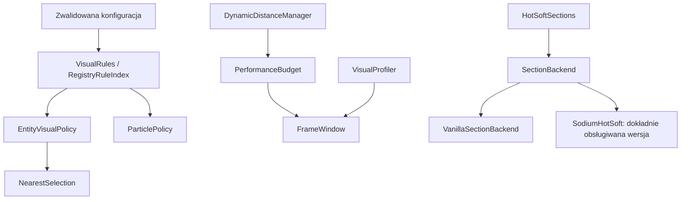

# Przegląd Java i refaktoryzacja — master / Minecraft 26.3

Wersja moda pozostaje **0.1.0**, autor **AdmerPRO**, licencja **GPL-3.0-only**.
Zmiany dotyczą wyłącznie mastera. Nie zmieniają Simulation Distance, serwerowych
mechanik ani symulacji encji. Format istniejącej konfiguracji i komendy pozostają
zgodne. Zmieniły się wewnętrzne klasy pomocnicze Java; nie są ogłoszonym API dla innych modów.

## Klasyfikacja wyników

- **WYKONANE** — zmiana jest w kodzie.
- **ZWERYFIKOWANE** — wskazany test lub narzędzie faktycznie uruchomiono.
- **WYMAGA OCENY** — wykryty problem nie został uznany za rozwiązany.
- **PROPOZYCJA** — pomysł na przyszłość, nie zaimplementowana funkcja.
- **NIEZMIERZONE** — brak dowodu na zmianę FPS, RAM lub VRAM.

Użyto skilla `clean-code-java`. Wskazywane przez niego pliki
`../_shared/COMMON_PRINCIPLES.md` i `../_shared/RESULT_CLASSIFICATION.md` nie były
obecne w zainstalowanym pakiecie. Powyższe etykiety są jawną klasyfikacją tego raportu.

## Wykonane zmiany

| Obszar | Przed zmianą | Po zmianie | Status |
|---|---|---|---|
| Entity Culling | Pełne liczenie ukrytych stanów co tick, wynik bez odbiorcy | Usunięte pole, getter i cała nieużywana pętla | WYKONANE |
| Manager RD | Getter liczby wpisów cache bez odbiorcy | Getter usunięty; używany cache i jego testy zachowane | WYKONANE |
| Cząsteczki | Zliczanie i parsowanie liczby również przy wyłączonej funkcji | Koszt występuje tylko przy włączonych limitach | WYKONANE |
| Reguły typów | Powtarzane registry ID → String i wyszukiwanie w mapach | `RegistryRuleIndex` rozwiązuje regułę raz na typ i konfigurację | WYKONANE |
| Liczniki | Opakowywane liczby i tekstowe klucze w ścieżce cząsteczek | Mapa według tożsamości typu z wartościami `int` | WYKONANE |
| Limity encji | Globalne sortowanie wszystkich kandydatów | `NearestSelection`: ograniczony kopiec dla każdego typu, O(N log K) | WYKONANE |
| Decyzje encji | Zestawy tracked i selected z opakowanymi ID | Jeden prymitywny zbiór ukrytych ID | WYKONANE |
| Zmiana świata/ustawień | Decyzje mogły przetrwać do kolejnego próbkowania | Jawne unieważnienie i kontrola tożsamości świata | WYKONANE |
| Historia klatek | Powielone bufory i obsługa indeksów | Wspólny `FrameWindow`; sortowanie percentyli używa prywatnego scratch | WYKONANE |
| Profiler | Nagrywanie historii także przy wyłączonym panelu | Nagrywanie tylko przy włączonym panelu | WYKONANE |
| Telemetria | Odczyt CPU również bez aktywnego konsumenta metryk | Warunek przed zegarem/JMX, reset po wyłączeniu próbkowania | WYKONANE |
| Profile RD | Nowe tablice progów i wartości przy każdej interpolacji | Stałe progi, odczyty konfiguracji bez tymczasowych tablic | WYKONANE |
| Promienie | Tymczasowy wektor UP i wektor środka AABB | Stały UP i bezpośrednie współrzędne środka | WYKONANE |
| Predykcja | Wynik double oraz ukryte mutowalne `previewSky` | Niemutowalny `Preview(openness, sky)` | WYKONANE |
| Sekcje | Powtarzane rozgałęzienia vanilla/Sodium w kontrolerze | `SectionBackend`, implementacja vanilla i adapter Sodium | WYKONANE |
| Dostęp do sekcji vanilla | Nowy BlockPos przy sprawdzaniu aktualizacji | Prywatny, ponownie używany MutableBlockPos w adapterze | WYKONANE |
| Cache komend Sodium | Zbiór wykluczeń dla każdej śledzonej grupy | Zbiór powstaje dopiero po pierwszym rzeczywistym pominięciu | WYKONANE |
| Unieważnianie Sodium | Kopia listy wszystkich grup przy każdej generacji | Iteracja po mapie; callback czyści wartości, nie zmienia jej struktury | WYKONANE |
| Konfiguracja | Null w zbiorze ważnych cząsteczek przechodził walidację | Usunięcie null przed budowaniem niemutowalnego indeksu | WYKONANE |
| Nullowalność | Niejawny brak wyniku przed pierwszą analizą | Adnotacje na wyniku analizy i konfiguracji dostępnej przed inicjalizacją | WYKONANE |

Kopiec zachowuje najbliższe K encji każdego typu. Remisy zachowują pierwszeństwo
wcześniejszych kandydatów, zgodne z poprzednim stabilnym sortowaniem. Tablice
rosną do potrzebnego rozmiaru, maksymalnie K; nie powstaje osobny obiekt wpisu dla
każdej rozpatrzonej encji. Zmiany decyzji nadal są próbkowane co 250 ms.

Nie usuwano metod tylko dlatego, że nie mają zwykłego wywołania w kodzie Java:
entrypointy Fabric, metody Mod Menu oraz hooki Mixin są wołane przez loader lub
transformowane klasy gry. Wyjątki PMD są wąskie i opisane przy kodzie.

## Architektura do rozbudowy



- **Granica renderera:** następny adapter implementuje zbieranie kandydatów,
  sprawdzanie gotowej geometrii i żądanie natywnej przebudowy. Kontroler hot/soft
  nie musi znać jego klas. Kontrakt wymaga wątku klienta i zakazuje żądania chunków.
- **Reguły i konfiguracja:** indeks ma kopię reguł tekstowych; rozwiązanie typu
  jest leniwe, więc nie wymaga skanowania rejestrów podczas inicjalizacji moda.
  Udane zastosowanie konfiguracji przebudowuje indeksy i unieważnia decyzje.
- **Selekcja niezależna od gry:** kopiec i indeks reguł można testować bez świata.
- **Wspólna telemetria:** jeden bufor ma jawne zasady pojemności, kolejności,
  odrzucania błędnych próbek i obliczania percentyli.
- **Jawny wynik analizy:** predykcja nie przenosi informacji przez poboczne,
  mutowalne pole obiektu.

Nie dodano kontenera DI, event busa ani własnego executora. Świat i natywne
struktury renderera nadal są czytane na wątku klienta. `SectionBackends` wiąże
opcjonalne klasy Sodium leniwie; nie wymaga ich na vanilla. Nieznane wersje
Sodium nadal nie uruchamiają dodatkowego filtra sekcji.

## Weryfikacja

Stan bazowy: `./gradlew build compileGametestJava` zakończył się poprawnie.
Po refaktoryzacji uruchomiono:

```sh
./gradlew build compileGametestJava dependencyInventory
./gradlew runClientGameTest
./gradlew runClientGameTest -PwithSodium
python3 scripts/audit-dependencies.py build/reports/security/dependencies.json
```

- **ZWERYFIKOWANE:** 72 testy jednostkowe, zero błędów; wcześniej 66.
- **ZWERYFIKOWANE:** PMD main/test/gametest, zero naruszeń wybranych reguł.
- **ZWERYFIKOWANE:** pełne testy klienta vanilla i Sodium z Mod Menu.
- Nowe testy sprawdzają kopiec względem stabilnego pełnego sortowania na 3000
  kandydatach, różne K i remisy; zawijanie historii, reset i percentyle; oraz
  rozwiązywanie reguł tylko raz i unieważnienie po zmianie konfiguracji.
- Test klienta sprawdza, że limit krów ukrywa dalszą, a nie bliższą krowę.
- Zachowane testy obejmują geometrię po zmianie RD, zmiany bloków, hot/soft,
  wyłączenie filtra, ważne cząsteczki, GUI i niezmienioną Simulation Distance.

PMD 7.28.0 jest narzędziem budowania, nie zależnością dołączaną do moda.
Sprawdza martwy kod prywatny, przypisania, importy, zasoby i wybrane pułapki
wyjątków. Nie jest pełnym dowodem braku błędów. Nie uruchamiano Checkstyle,
SpotBugs ani OWASP Dependency-Check; użyto PMD i rzeczywistego zapytania OSV.
PMD zgłasza informacyjne ostrzeżenie o automatycznie dodanym jrt-fs.jar; proces
uruchamiano z JDK 25. Skrypt audytu zwraca 0 bez znanych wpisów, 1 przy wykrytych
identyfikatorach podatności i 2 przy niekompletnym sprawdzeniu.

## Bezpieczeństwo — wymaga oceny

[Zapis wyniku OSV](security-review.json) zawiera czas sprawdzenia i identyfikatory.
Zapytano o **126 współrzędnych Maven**, otrzymując **11 identyfikatorów** dla pięciu
bibliotek: LZ4, Guava, netty-codec-http, netty-handler i log4j-api. Wszystkie pięć
wersji występuje w manifeście Minecrafta 26.3. Audyt zakończył się kodem 1,
więc tego sprawdzenia nie oznaczono jako „czyste”.

Nie badano osiągalności konkretnych podatnych metod ani kompletności indeksacji
Minecraft/Fabric/Modrinth w OSV. Nie uznano wszystkich alertów za możliwe do
wykorzystania w tym modzie. Nie wymuszono podmiany bibliotek gry: wymaga to
oddzielnego przeglądu zgodności z loaderem i innymi modami. Narzędzia/build pluginy
nie są objęte tym spisem. Metoda zapytań opiera się na
[oficjalnym API OSV](https://google.github.io/osv.dev/post-v1-querybatch/).

Przejrzano obsługę zasobów, wyjątków i dostępu do świata. Pliki konfiguracji używają
zarządzanych metod `Files` i atomowego zastąpienia z fallbackiem; błędy są logowane.
Referencje do Minecrafta, świata i natywnych meshów są pożyczone i nie wolno ich
zamykać w modzie. Brak ręcznie tworzonych wątków oraz operacji SQL.

## Granice wyniku

**NIEZMIERZONE:** przyrost FPS po tej refaktoryzacji. Usunięcie zbędnej pracy,
boxingów i globalnego sortowania jest widoczne w implementacji; nie zastępuje
pomiaru czasu klatek na farmie lub z dużą liczbą cząsteczek. Nie przepisano
wcześniejszych wyników hot/soft jako wyników nowej wersji kodu. Nie deklarujemy
oszczędności RAM/VRAM geometrii, ponieważ natywna geometria nadal pozostaje w cache.

[Propozycje dalszego zwiększania wydajności](performance-roadmap.md) są opisane
oddzielnie i nie stanowią listy już wdrożonych funkcji.
